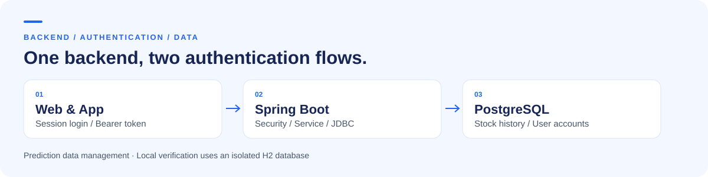
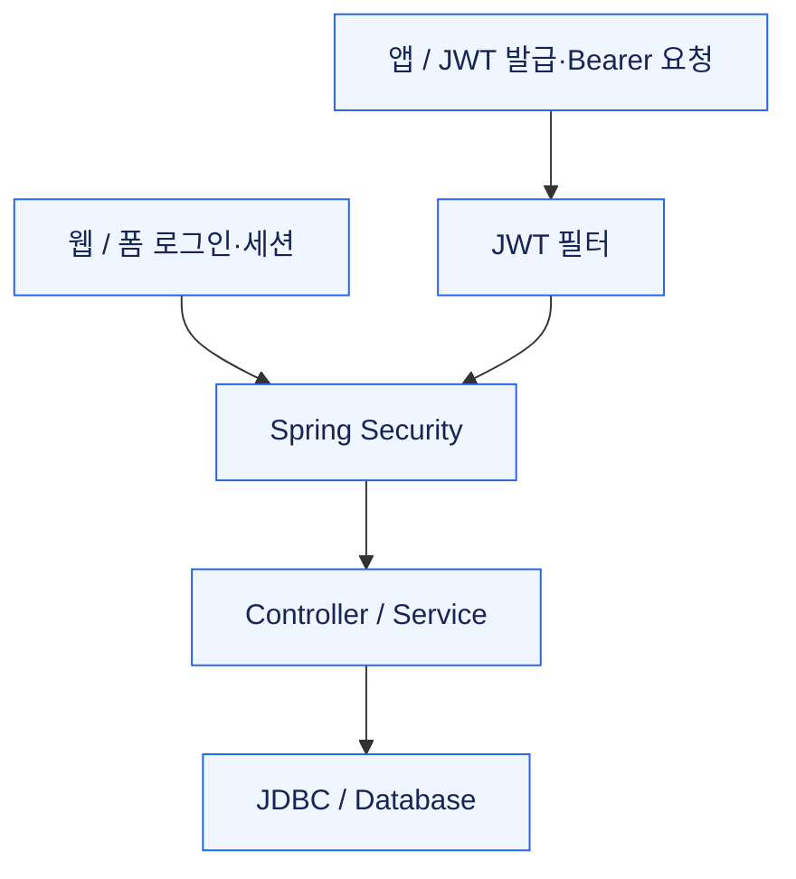

<!-- 프로젝트 개요·구현 흐름·실행 안내 -->
# AiStock Backend

**웹·앱 인증과 주가 예측 데이터의 저장·검색·이력을 관리하는 Spring Boot 백엔드**


**2인 팀 프로젝트** · 조동휘: 백엔드·아키텍처 · 팀원: DB·AI

[핵심 구현](#핵심-구현) · [프로젝트 구조](#project-structure) · [API](docs/API.md) · [로컬 실행](docs/SETUP.md) · [검증 기록](docs/VALIDATION.md)

<picture>
  <source media="(max-width: 600px)" srcset="docs/assets/overview-mobile.svg">
  
</picture>

## 프로젝트 개요

- AI 예측 가격·현재 가격 저장, 종목·날짜·활성 상태별 조회 구현
- 웹 관리 화면의 세션 로그인과 앱 API의 JWT 인증 연결
- 담당 범위: **예측 결과를 다루는 백엔드**, AI 모델·DB 설계는 팀원 담당

## 핵심 구현

### 01. 웹 세션과 JWT 인증 연결

- Spring Security에서 웹 세션·앱 JWT 인증 연결, BCrypt 비밀번호 해싱 적용
- JWT 검증 후 인증 정보 설정, 인증된 요청에 주식 화면·API 접근 허용

<details>
<summary>인증 흐름 보기</summary>



</details>

[보안 설정](src/main/java/nemsi/aistock/config/SecurityConfig.java) · [JWT 필터](src/main/java/nemsi/aistock/config/JwtAuthenticationFilter.java) · [로그인 API](src/main/java/nemsi/aistock/controller/UserApiController.java)

- 세션·JWT 혼합 구성, API 전용 무상태 필터 체인 분리는 후속 과제

### 02. 예측 결과의 이력과 활성 상태 관리

- 같은 종목·날짜의 새 데이터 저장 시 기존 레코드 `useYN=N`, 새 레코드 `Y` 처리
- `(ticker, date, id)`로 예측 이력 구분

- Gap = **예측 가격 - 현재 가격** (현재가 150·예측가 160 → 10, 비율 아님)

[계산 로직](src/main/java/nemsi/aistock/service/PreStockService.java) · [이력 저장 로직](src/main/java/nemsi/aistock/repository/JdbcPreStockRepository.java)

### 03. 입력된 조건만 사용하는 검색

- 입력된 검색 조건만 SQL·바인딩 값에 추가
- 티커·날짜·활성 상태 일치 검색, 종목명 부분 일치 검색 구현

[검색 API](src/main/java/nemsi/aistock/controller/StockApiController.java) · [검색 테스트](src/test/java/nemsi/aistock/controller/StockApiControllerTest.java)

<a id="project-structure"></a>

## 📂 프로젝트 구조

주요 코드·문서 기준.

```text
AI-stock-backend/
├── src/main/java/nemsi/aistock/  # 백엔드 코드
│   ├── config/  # 인증·JWT·의존성 설정
│   ├── controller/  # 웹·API 진입점
│   ├── service/  # 인증·예측 이력 처리
│   ├── domain/  # 사용자·예측 데이터 모델
│   └── repository/  # JDBC 데이터 접근
├── src/main/resources/  # 설정·화면·DB 초기화
│   ├── templates/  # Thymeleaf 화면
│   ├── schema.sql  # 테이블 정의
│   └── application-local.properties  # 로컬 H2 설정
├── src/test/  # 계층별·통합 테스트
├── docs/  # API·실행·검증 문서
└── build.gradle  # 빌드·의존성 설정
```

## 검증과 실행

- JDK 17·Gradle 8.13·로컬 H2에서 **총 16개 테스트 통과** (기존 13개 + 설정 3개)
- 로컬 실행·HTTP 흐름 확인, 운영 환경 검증 제외 → [검증 기록](docs/VALIDATION.md)

- [로컬 실행 안내](docs/SETUP.md): JDK·Gradle 준비, 원격 DB를 사용하지 않는 H2 실행 절차
- [API 안내](docs/API.md): 인증, 검색 조건, 응답 예시
- [DB 스키마](src/main/resources/schema.sql): 현재 구현의 테이블 정의

## 현재 한계와 다음 개선

- 동시 저장·ID 충돌, 오류 응답 통일, 인증 설정 분리·실패 시나리오 보강 필요
- 운영 PostgreSQL·인증 경계 등 남은 확인 범위: [검증 기록](docs/VALIDATION.md)

<details>
<summary>기술 구성</summary>

| 영역 | 사용 기술 |
| :--- | :--- |
| 서버 | Java 17, Spring Boot 3.4.1 |
| 인증 | Spring Security, JJWT 0.11.5, BCrypt |
| 저장소 | Spring JDBC, PostgreSQL, H2 |
| 화면 | Thymeleaf, Bootstrap |
| 테스트 | JUnit 5, Spring Boot Test, MockMvc |


</details>
